<div align="center">

# NirnAIn — AI-Assisted Project Planning Platform

**From raw meeting notes to a feasible, explainable project plan, kept current as things change.**

**[▶ Live demo: nirnain-web.onrender.com](https://nirnain-web.onrender.com)** · sign in as `jane.doe@nirnain.demo` / `JaneDemo2026!`
<br/><sub>Free hosting: the first page can take about a minute while the API wakes up.</sub>

Authors: Sharada Dogiparthi (Team Lead), Srilekha Budithi, Rakshitha Venigella<br/>
BAN 693 Capstone Project, California State University, East Bay

[](https://github.com/Dogiparthi-Sharada/NirnAIn/actions/workflows/keepalive.yml)


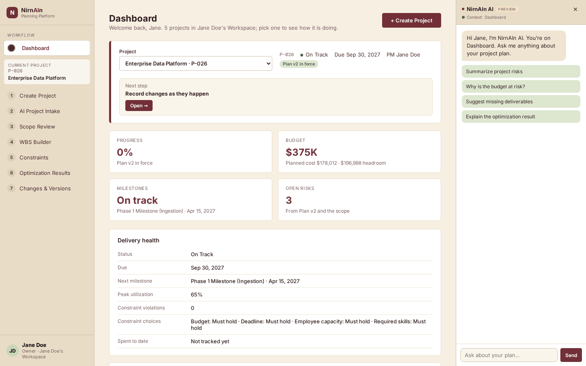

</div>

NirnAIn's AI features (Anthropic Claude) turn meeting notes, documents and transcripts into structured scope. The
project manager reviews it and builds a Work Breakdown Structure. An optimizer (Google OR-Tools CP-SAT) then produces
a schedule and staffing plan that respects the real budget, deadline, team hours and skills, and explains every
trade-off. When something changes mid-project, NirnAIn re-plans with as little disruption as possible and keeps every
applied plan as a version (Plan v1, v2, …).

The AI features are AI intake (scope from notes), WBS generation and AI review, step-7 change detection and the
planning assistant. Intake, the WBS features and change detection each have a deterministic rule-based fallback, so
the whole planning flow also runs without an AI key; only the assistant then says it is unavailable.

## Contents

- [Features](#features)
- [How it works](#how-it-works)
- [Screenshots](#screenshots)
- [Tech stack](#tech-stack)
- [Quick start (local)](#quick-start-local)
- [Testing](#testing)
- [Hosting](#hosting)
- [Project documentation](#project-documentation)
- [Repository layout](#repository-layout)
- [Contributing](#contributing)

## Features

- **Seven guided steps**, from a blank project to an applied plan and its later versions.
- **AI intake with evidence.** Every extracted scope item shows the quote it came from; nothing is invented. PDF,
  Word and meeting transcripts (.vtt, .srt, .txt) up to 100 MB.
- **WBS builder** with confirmed estimates, owners, skill tags and validation.
- **Must hold or Can flex** for budget, deadline, capacity and skills, with a recommendation for each.
- **A real optimizer.** Durations follow the person (part-timers stretch tasks, higher skill is faster), the budget
  reserve is held back, and an infeasible plan names every blocker in plain English.
- **The PM decides.** When a plan slips, NirnAIn prices the ways to keep the date: bring in a contractor, overtime,
  or accept the new date.
- **Changes and versions.** New meeting notes, edits or progress lead to a re-plan from today, a day-level comparison
  and, once approved, the next plan version. An outdated plan can never be applied.
- **Secure by design.** Supabase Row Level Security on every table; the API runs each request as the signed-in user.
- **Exports** to PDF and MS Project XML.

## How it works

### The seven steps

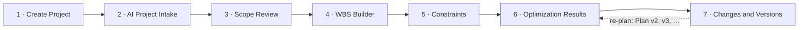

### Architecture

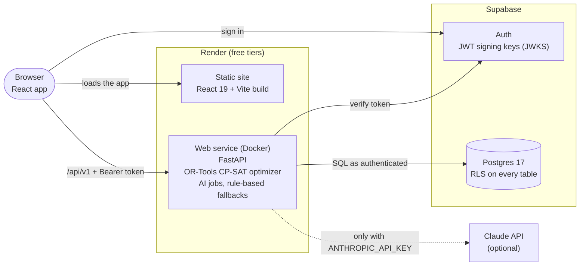

### Sign-in and request flow

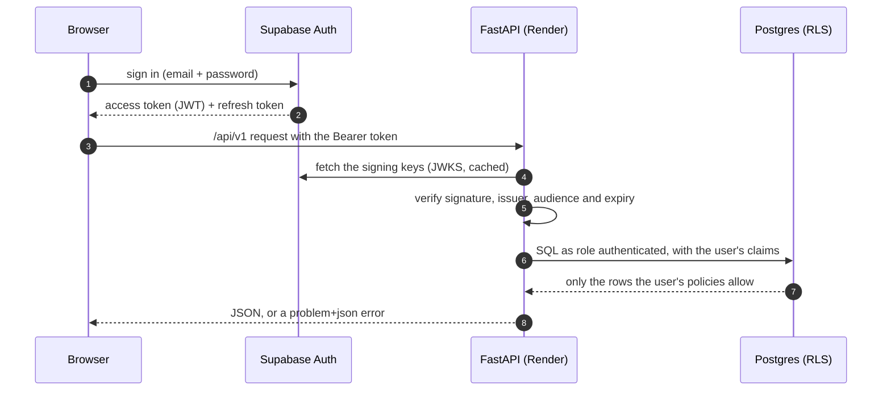

## Screenshots

Real screens from the demo build (seeded demo data: Jane Doe's workspace).

| | |
|---|---|
| **1 · Create Project:** a form, or start from a transcript or document<br/>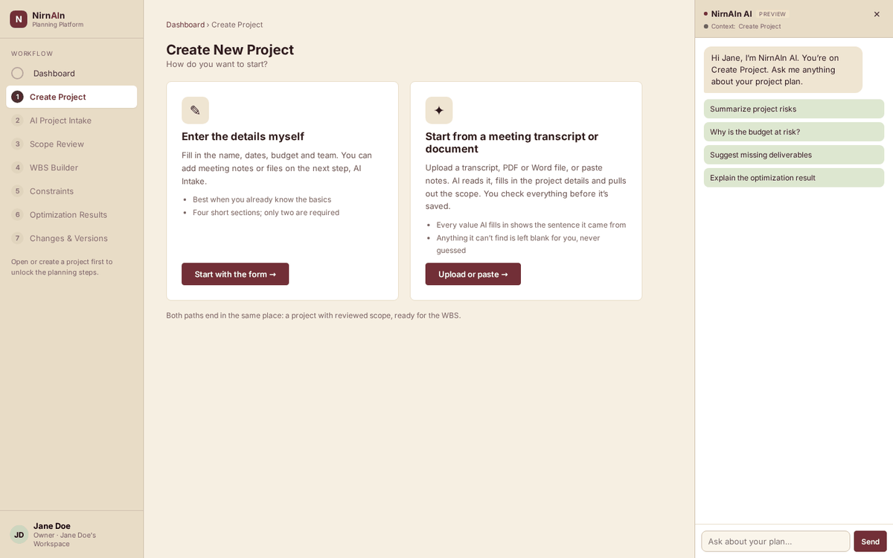 | **2 · AI Project Intake:** notes and uploads; every item quoted<br/>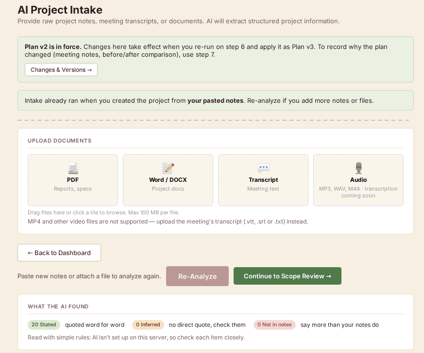 |
| **3 · Scope Review:** accept, edit or remove each item, with its quote<br/>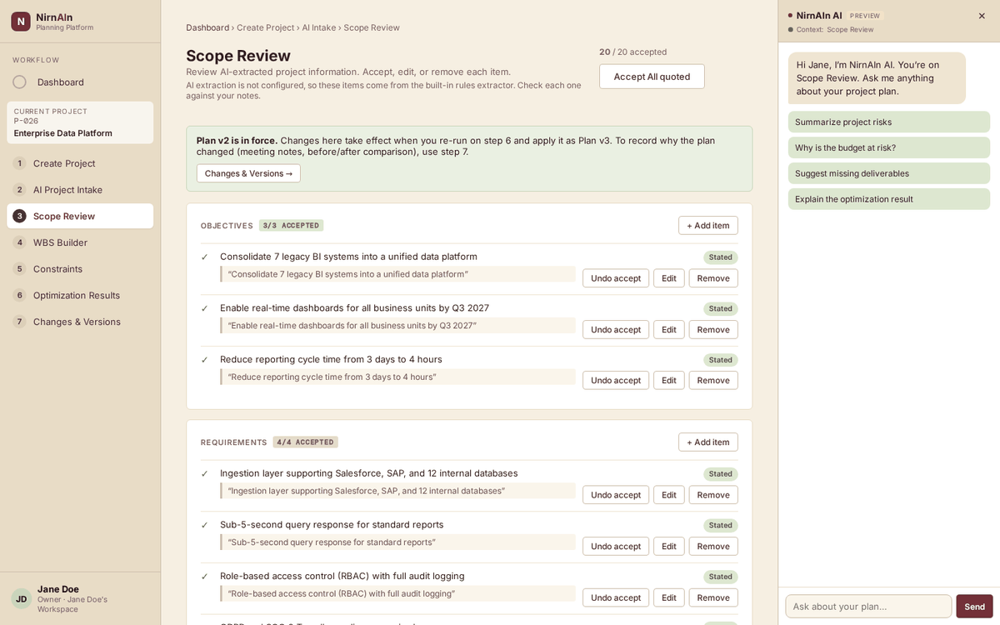 | **4 · WBS Builder:** packages, durations, owners and skill tags<br/>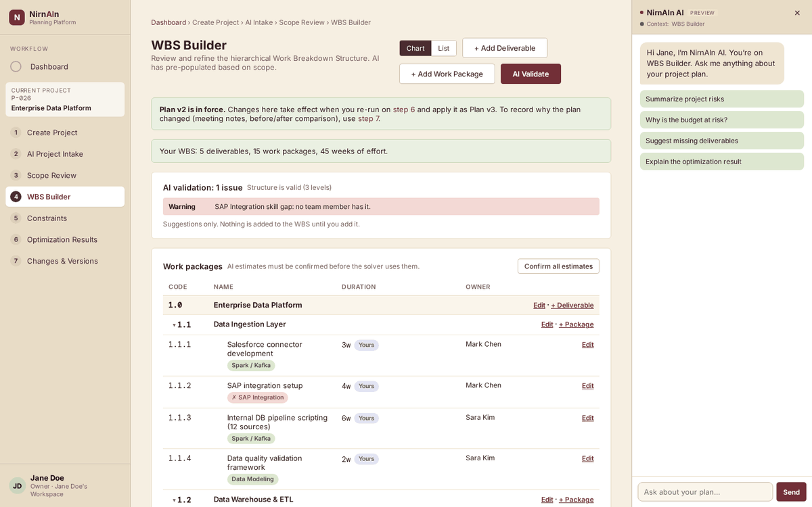 |
| **5 · Constraints:** only the questions that change the plan; Must hold or Can flex<br/>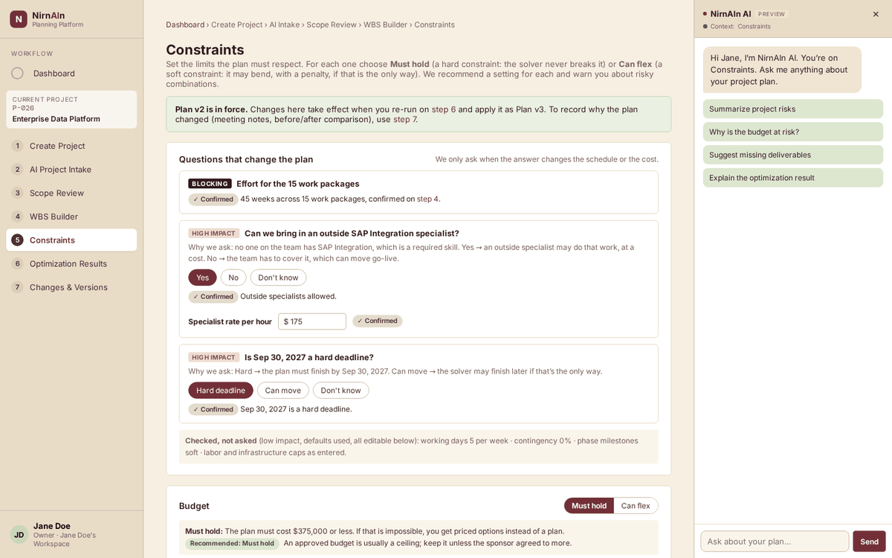 | **6 · Optimization Results:** priced ways to keep the date (test project)<br/>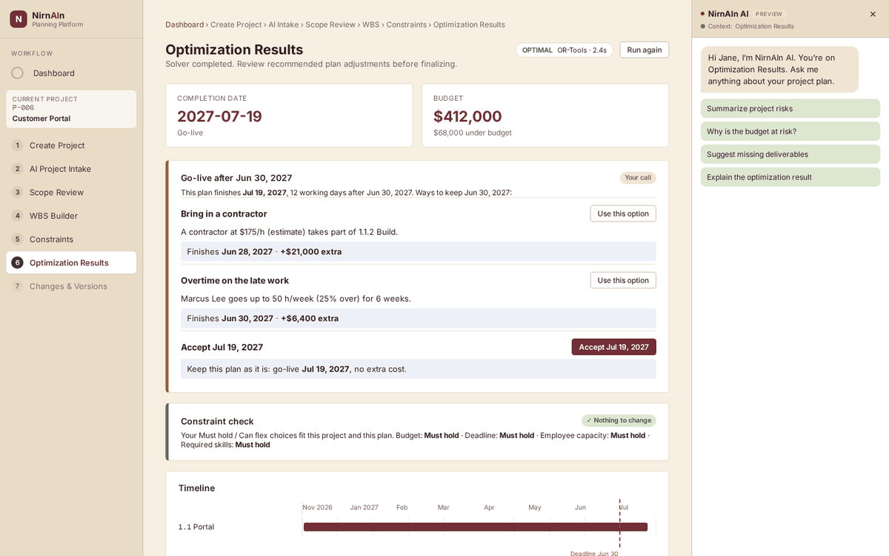 |
| **7 · Changes and Versions:** record a change; Plan v1 superseded by Plan v2<br/>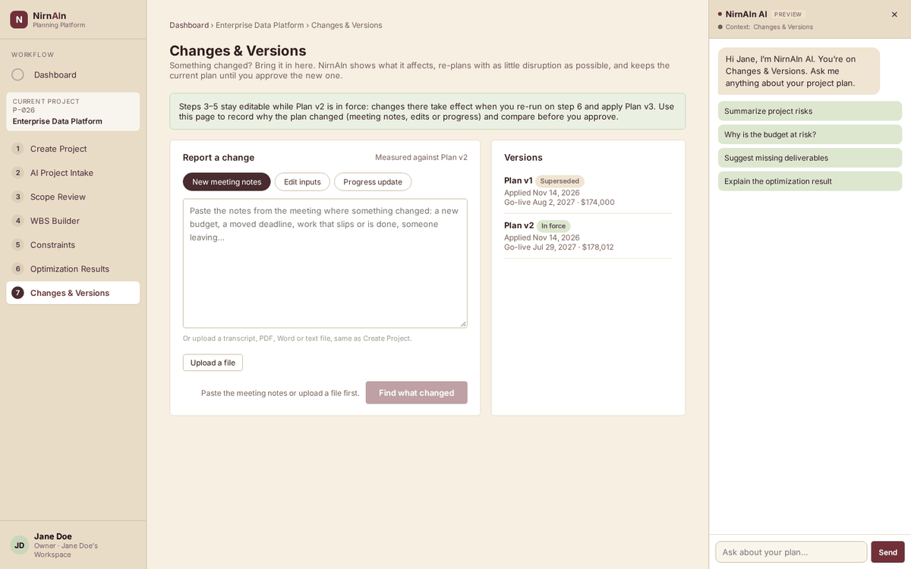 | **Dashboard:** status, budget, milestones and delivery health<br/> |

## Tech stack

| Layer | Technology | Folder |
|-------|------------|--------|
| Web app | React 19 · Vite · Tailwind v4 · TypeScript · React Router 7 · TanStack Query · supabase-js (sign-in) | `src/` |
| API | Python 3.12 · FastAPI · SQLAlchemy 2 (async, asyncpg) · pydantic v2 · OR-Tools CP-SAT | `backend/` |
| AI | Anthropic Claude through `backend/app/ai/` (key on the API only); rule-based fallbacks | `backend/app/ai/` |
| Database and sign-in | Supabase: Postgres 17, Auth, Row Level Security (17 migrations, pgTAP tests) | `supabase/` |
| Hosting | Render static site + Render web service (Docker) + Supabase, all on free plans | `backend/Dockerfile`, [docs/DEPLOY_DEMO.md](docs/DEPLOY_DEMO.md) |
| Automation | GitHub Actions: web, api and database checks (`ci.yml`, currently disabled) and a daily keep-alive (`keepalive.yml`) | `.github/workflows/` |

Package managers: **pnpm** for the web app, **uv** for the API.

## Quick start (local)

```bash
# Web app
pnpm install
cp .env.example .env.local        # Supabase URL + publishable key, API URL
pnpm dev                          # http://localhost:8443

# API
cd backend
uv sync
cp .env.example .env              # DATABASE_URL, SUPABASE_URL, CORS_ORIGINS
uv run uvicorn app.main:app --reload --port 8000
```

The database schema comes only from `supabase/migrations/`: apply it with the Supabase CLI (see
[supabase/README.md](supabase/README.md)). Without `ANTHROPIC_API_KEY` the API uses its rule-based fallbacks.
Team engineering guidelines: [CONTRIBUTING.md](CONTRIBUTING.md). Architecture and roadmap: [plan.md](plan.md).
Where is the code for a feature? [INDEX.txt](INDEX.txt) is the feature-to-code map; regenerate it with
`python3.12 scripts/build_code_index.py`.

## Testing

| What | Command | Where it runs |
|------|---------|---------------|
| Web app: types and build | `pnpm exec tsc --noEmit -p . && pnpm build` | locally (and in CI) |
| API: lint, format, types, tests | `cd backend && uv run ruff check . && uv run ruff format --check . && uv run mypy app && uv run pytest` | locally (and in CI) |
| Database: migrations, RLS, pgTAP | `supabase start && supabase db lint && supabase test db` (needs Docker) | locally with Docker (and in CI) |
| API end-to-end scenarios (~240 checks, 0 AI tokens) | `python3.12 tests/e2e/api/run_api_suite.py --fresh-workspace` | locally, against a running API without an AI key |
| Demo data (Jane Doe's projects, 0 AI tokens) | `python3.12 scripts/seed_demo/seed_demo.py --ai-calls rules` (or `--ai-calls skip` against an API with a Claude key) | locally or against the hosted API |

Every suite with its exact command and settings: [tests/README.md](tests/README.md). The API tests use in-memory fakes and never call a real AI model. The database tests prove that one workspace can't
read or write another's data. The CI workflow (`.github/workflows/ci.yml`) is currently disabled in this repository,
so run these checks locally before you push.

## Hosting

The live demo runs on free plans, with no credit card:

| Part | Where | Free plan |
|---|---|---|
| Website | **Render static site**: <https://nirnain-web.onrender.com> | Always on |
| API | **Render web service** (Docker, Virginia): <https://nirnain-api.onrender.com> | Sleeps after 15 idle minutes, about 1 minute to wake; 750 instance hours a month |
| Database and sign-in | **Supabase** (us-east-1) | Pauses after 1 week without activity; **Restore project** brings it back |

- **Daily keep-alive:** [`.github/workflows/keepalive.yml`](.github/workflows/keepalive.yml) runs at 13:17 UTC. It
  wakes the API, checks `/health/ready` (the database) and Supabase Auth health, and loads the website, so the free
  Supabase project never pauses. It uses the repository variables `SUPABASE_PROJECT_REF` and
  `SUPABASE_PUBLISHABLE_KEY` and calls health endpoints only (no Claude tokens). GitHub disables scheduled workflows
  in a public repository after 60 days without commits: re-enable it under **Actions** → the workflow →
  **Enable workflow**.
- **AI:** the hosted API has `ANTHROPIC_API_KEY`, so Claude powers the AI features; keep a monthly spend limit in the
  Anthropic Console (**Settings** → **Limits**). Without a key the AI features fall back to the rules (the assistant
  is then unavailable). Never put the key on the static site.
- **Version:** the API's `/health` reports the deployed commit (Render's `RENDER_GIT_COMMIT`).
- Step-by-step guide: [docs/DEPLOY_DEMO.md](docs/DEPLOY_DEMO.md) (also as [Word](docs/project/DEPLOY_DEMO.docx) and
  [plain text](docs/project/DEPLOY_DEMO.txt))
- A 16-step checklist that points into the guide: [HOSTING_QUICKSTART.docx](docs/project/HOSTING_QUICKSTART.docx)
  ([.txt](docs/project/HOSTING_QUICKSTART.txt))

## Project documentation

The documentation package for the NirnAIn demo is in [docs/project/](docs/project/). Every document comes as Word (.docx) and plain text (.txt):

| Document | Word | Text |
|---|---|---|
| Read me first | [README.docx](docs/project/README.docx) | [README.txt](docs/project/README.txt) |
| Final project report | [FINAL_PROJECT_REPORT.docx](docs/project/FINAL_PROJECT_REPORT.docx) | [FINAL_PROJECT_REPORT.txt](docs/project/FINAL_PROJECT_REPORT.txt) |
| Applied research report (final report v2; also [PDF](docs/project/FINAL_PROJECT_REPORT_v2.pdf)) | [FINAL_PROJECT_REPORT_v2.docx](docs/project/FINAL_PROJECT_REPORT_v2.docx) | [FINAL_PROJECT_REPORT_v2.txt](docs/project/FINAL_PROJECT_REPORT_v2.txt) |
| Architecture and design decisions | [ARCHITECTURE_AND_DESIGN_DECISIONS.docx](docs/project/ARCHITECTURE_AND_DESIGN_DECISIONS.docx) | [ARCHITECTURE_AND_DESIGN_DECISIONS.txt](docs/project/ARCHITECTURE_AND_DESIGN_DECISIONS.txt) |
| Lessons learned | [LESSONS_LEARNED.docx](docs/project/LESSONS_LEARNED.docx) | [LESSONS_LEARNED.txt](docs/project/LESSONS_LEARNED.txt) |
| Hosting quick start | [HOSTING_QUICKSTART.docx](docs/project/HOSTING_QUICKSTART.docx) | [HOSTING_QUICKSTART.txt](docs/project/HOSTING_QUICKSTART.txt) |
| Full hosting guide | [DEPLOY_DEMO.docx](docs/project/DEPLOY_DEMO.docx) | [DEPLOY_DEMO.txt](docs/project/DEPLOY_DEMO.txt) |
| How the code is kept on GitHub | [GITHUB_UPLOAD_STEPS.docx](docs/project/GITHUB_UPLOAD_STEPS.docx) | [GITHUB_UPLOAD_STEPS.txt](docs/project/GITHUB_UPLOAD_STEPS.txt) |

Presentation: [NirnAIn_Project_Overview.pptx](docs/project/NirnAIn_Project_Overview.pptx) (18 slides with speaker notes).

API and database guides: [backend/README.md](backend/README.md) · [supabase/README.md](supabase/README.md).
Feature-to-code map: [INDEX.txt](INDEX.txt).

## Repository layout

```text
.
├── src/                    React app: screens (one per step), lib (API hooks, types), styles from the approved design
├── backend/                FastAPI service
│   ├── app/optimization/   OR-Tools CP-SAT optimizer (formulation in solver.py)
│   ├── app/ai/             Claude prompts and the rule-based fallbacks
│   ├── app/api/v1/         REST endpoints (/api/v1)
│   └── tests/              unit and API tests (no database needed)
├── supabase/
│   ├── migrations/         the only way the schema changes (17 files)
│   └── tests/database/     pgTAP tests (RLS isolation, triggers, constraints)
├── tests/
│   ├── README.md           every test suite and its command
│   └── e2e/api/            API end-to-end scenario suite (~240 checks, 0 AI tokens)
├── scripts/
│   ├── seed_demo/          demo data: Jane Doe's five projects
│   └── build_code_index.py generates INDEX.txt
├── docs/
│   ├── DEPLOY_DEMO.md      hosting guide (Render + Supabase)
│   ├── project/            documentation package (.docx, .txt, .pdf, .pptx)
│   └── images/             screenshots used in this README
├── .github/workflows/      ci.yml (checks, currently disabled) and keepalive.yml (daily)
├── CONTRIBUTING.md         team engineering guidelines
├── INDEX.txt               feature-to-code map ("where is the code for …?")
└── plan.md                 original architecture and roadmap
```

## Contributing

Team engineering guidelines: [CONTRIBUTING.md](CONTRIBUTING.md). Step by step, with the secret checks before every
push: [How the code is kept on GitHub](docs/project/GITHUB_UPLOAD_STEPS.txt).

1. Update `main` (`git pull --ff-only`); for a bigger change, branch from it: `git switch -c feat/<area>-<thing>`.
2. Run the checks in [Testing](#testing) locally: the CI workflow is currently disabled.
3. Merge into `main` only when every check passes, and push. Render redeploys the website and the API from `main`.
   Apply a new database migration with `npx supabase@latest db push --remote` ([docs/DEPLOY_DEMO.md](docs/DEPLOY_DEMO.md), step 1.5).
