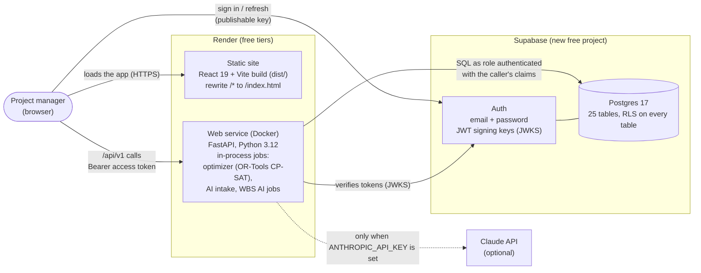
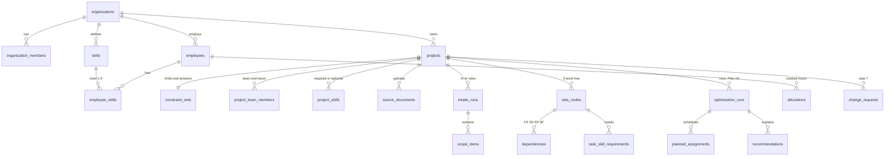
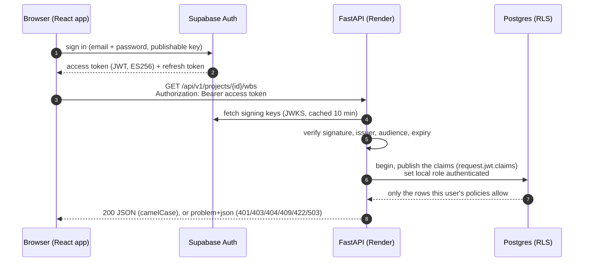
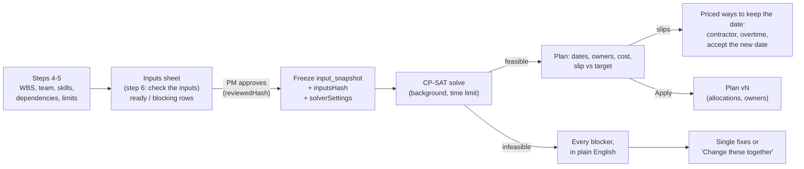

# NirnAIn: architecture and design decisions

How the NirnAIn demo is built, and why. This covers the state of the integration branch `demo/mockup` on
November 14, 2026. The original backend plan is in [plan.md](../../plan.md) and the team rules are in
[AGENTS.md](../../AGENTS.md). The API and database guides are [backend/README.md](../../backend/README.md) and
[supabase/README.md](../../supabase/README.md).

Contents:

1. [System overview](#1-system-overview)
2. [Data model highlights](#2-data-model-highlights)
3. [Request and sign-in flow](#3-request-and-sign-in-flow)
4. [The optimizer](#4-the-optimizer)
5. [AI features and their rule-based fallbacks](#5-ai-features-and-their-rule-based-fallbacks)
6. [Security](#6-security)
7. [Decision log](#7-decision-log)

---

## 1. System overview

NirnAIn has three parts: a single-page web app, an API, and Supabase (database and sign-in). Claude is optional.
Every AI feature has a rule-based fallback, so the demo runs without an AI key.

| Part | Technology | Folder | Hosted on (demo) |
|---|---|---|---|
| Website | React 19, Vite, Tailwind v4, TypeScript, React Router 7, TanStack Query, supabase-js (sign-in only) | `src/` | Render static site |
| API | Python 3.12, FastAPI, SQLAlchemy 2 Core (async, asyncpg), OR-Tools CP-SAT, pydantic v2 | `backend/` | Render web service (Docker, `backend/Dockerfile`) |
| Database and sign-in | Supabase: Postgres 17, Auth, Row Level Security | `supabase/` (17 migrations, pgTAP tests 001–014) | New Supabase free project |
| AI | Anthropic Claude through `backend/app/ai/llm.py` only | `backend/app/ai/`, `drafts/`, `changes/` | Anthropic API (optional) |
| CI | GitHub Actions: web, api and db checks on every pull request | `.github/workflows/ci.yml` | GitHub |

Shape of the API: a modular monolith (plan.md §2.2) without Redis. Long work (optimization, intake, WBS AI jobs) runs
in the API process as background tasks with a job row in Postgres. Runs left in `queued`/`running` by a restart are
marked failed on start-up (`OPTIMIZER_STALE_AFTER_S`, default 180 s).

Main backend packages (`backend/app/`):

| Package | What it holds |
|---|---|
| `api/v1/` | Routers: me, orgs, projects, dashboard, overview, notifications, drafts, documents, intake, wbs, planning, team, optimization, plan (apply, versions, exports), changes, AI jobs, assistant, health |
| `core/` | Settings, database sessions under RLS, token verification, RFC 7807 errors, JSON logging, middleware (request id, security headers), keyset pagination |
| `optimization/` | The pure CP-SAT optimizer: input model, baseline, solver and builder, blockers, remedies, costing, speed, workload, inputs sheet and fingerprint |
| `ai/`, `drafts/`, `changes/` | Claude prompts and the rule-based fallbacks: intake, project drafts, WBS generate/validate, step-7 change detection |
| `jobs/` | In-process workers: optimizer, intake, AI jobs |
| `repositories/` | SQLAlchemy Core queries against the tables defined by the migrations (the backend owns no schema) |
| `export/` | Plan exports: PDF and MS Project XML |

The website has one screen per step (`src/screens/`) plus the landing page, sign-in pages and the dashboard. Routes:
`/`, `/login`, `/signup` (`/register` redirects), `/dashboard`, `/projects/new`, and `/projects/:projectId/intake |
scope | wbs | constraints | optimization | changes`.

---

## 2. Data model highlights

The schema lives only in `supabase/migrations/` (17 files, `20260924000100_foundation.sql` to
`20261114000200_source_documents_truncated.sql`). It has 25 tables in `public`. The most important ones:

| Area | Tables | Notes |
|---|---|---|
| Tenancy | `organizations`, `organization_members`, `profiles` | A sign-up creates a profile and a workspace ("<name>'s Workspace") by trigger. Roles: owner, admin, pm, member, viewer. |
| Projects | `projects`, `notifications`, `audit_events` | Project codes `P-001`, `P-002`… per workspace. |
| Intake | `source_documents`, `intake_runs`, `scope_items`, `ai_jobs` | Only the text of an upload is kept (up to 200,000 characters per file, with a `truncated` flag). Scope items carry `source_quote`, `evidence` (`stated`, `inferred`, `flagged`) and `suggested_text`. |
| WBS | `wbs_nodes` (+ view `wbs_nodes_with_code`), `dependencies`, `task_skill_requirements`, `milestones` | WBS codes such as 1.2.3 are computed from tree position, not stored. Dependencies point at stable ids. AI estimates count only once confirmed (`estimate_confirmed_at`). |
| Resources | `employees`, `employee_skills`, `skills`, `allocations`, `project_team_members`, `project_skills` | People are organization-wide; `project_team_members.hours_per_week` (1–80) is what they give this project. `employees.is_contractor` is the worker type. |
| Constraints | `constraint_sets` | Budget, reserve, caps, deadline, modes (`hard` = Must hold, `soft` = Can flex), the specialist and deadline answers, contractor rate. |
| Optimization | `optimization_runs`, `planned_assignments`, `recommendations` | A run stores its frozen `input_snapshot`, its `options` (overrides, remedy, `inputsHash`, `solverSettings`), its `result` (summary, remedies), `iis` when infeasible, and `version` once applied. |
| Changes | `change_requests` | Step 7: source (`notes`, `edits`, `progress`), status, impact, answers, base and proposed runs. |

Conventions (AGENTS.md): money is `bigint` cents, durations are integer working days (1 week = 5 days), timestamps are
`timestamptz`, JSON is camelCase on the wire, errors are RFC 7807 problem+json.

---

## 3. Request and sign-in flow

The browser signs in with Supabase Auth (supabase-js and the public publishable key). It then calls the API with the
access token. The API never trusts the browser for authorization. It checks the token, then runs the SQL as the
Postgres role `authenticated` with the caller's claims, so the database's Row Level Security decides what the caller
can see and change.

- **Token check** (`app/core/security.py`): ES256/RS256 tokens are verified against the project's JWKS. Legacy HS256
  tokens are accepted only when `SUPABASE_JWT_SECRET` is set. Tokens are never logged.
- **Database session** (`app/core/db.py`): every request opens a transaction, publishes the verified claims the way
  Supabase's own API does, and switches to `authenticated`. `auth.uid()` and every policy then behave exactly as
  they would for that user. A row the policy hides answers 404; a policy refusal answers 403.
- **Background jobs** (optimizer, intake, AI jobs) read the user's data under the user's RLS session when the job is
  queued, freeze it, and write their results on a separate service connection. User-facing endpoints never use the
  service connection.
- **Errors**: RLS violation → 403, trigger message (`P0001`) → 422, unique violation → 409, check/foreign-key
  violations → 422, database unreachable or timeout → 503. Each answer carries a `requestId`.

---

## 4. The optimizer

`backend/app/optimization/` is a pure Python package (no database or web imports) built on Google OR-Tools CP-SAT.
`solver.py`'s module docstring documents the full formulation.

### What the model decides

- **Who does each work package, and when.** Time is in working days. Each package gets exactly one person (or a
  contractor profile), a start and an end. Dependencies FS/SS/FF/SF with lags are respected.
- **Durations depend on the person (assignment-dependent durations).** Each (package, person) pair has its own
  duration and daily load:
  - **Part-time stretch.** Someone who can't give the daily demand takes `ceil(effort / their daily hours)` working
    days. Cutting a person to 16 h/week makes their tasks longer and moves the date, instead of overbooking them
    (QA bug B1, fixed in round 1).
  - **Skill speed (decision D5).** Each skill level above the package's minimum is 10% faster (at most 30%). Each
    level below (only when skills are "Can flex") is 25% slower. The hours, and so the cost, scale with it.
  - Contractor profiles keep the WBS duration; they stand for whoever is hired.
- **Capacity.** Per person, the daily load of overlapping work must fit their hours. Hours already booked on other
  projects reduce the free hours on those days.
- **Cost.** Labor only: effort hours × rate. Employees use the company-record rate, else the standard $85/h (shown as
  an assumption). Contractors use their own rate (decision D1). Overtime costs 1.5× for employees, the normal rate
  for contractors. Infrastructure isn't modelled.

### Must hold and Can flex (hard and soft constraints)

For budget, deadline, capacity and skills the PM chooses **Must hold** (a hard constraint: never broken) or **Can
flex** (a soft constraint: may bend, with a penalty, if that's the only way). `src/lib/constraintPolicy.ts`
recommends a setting and warns about risky combinations.

| Limit | Must hold | Can flex |
|---|---|---|
| Budget | cost + reserve ≤ budget | penalty per $1,000 over (budget − reserve) |
| Deadline / milestones | finish by the date | penalty per working day late |
| Capacity | never over a person's hours | up to 125% of their hours (overtime, paid); kept only when it keeps a date or saves money |
| Skills | only qualified people | anyone, with a penalty per missing level (and 25% slower per level) |

### The reserve

The contingency reserve (`contingency_pct`) is held back from the budget. With a $1,100 budget and a 10% reserve, a
$1,000 plan is infeasible by $10 (the QA pack's micro-oracle). The inputs sheet says so: "Reserve · 10% = $110,000
held back".

### Objective

In cents: labor cost + $200 per working day of makespan + soft-constraint penalties + $500 per package moved off its
current owner + $10 per working day a package starts after its baseline start (+ a target-date penalty, only in the
runs that try to keep a date). The move penalty keeps re-plans close to the plan in force, so changes stay few and
explainable.

### Blockers and remedies

- **Every blocker named (round 3, R6).** When no plan fits, the model is rebuilt with each hard constraint group behind
  an assumption. CP-SAT returns a conflicting set; its headline group is relaxed and the search repeats (up to 5
  times), so independent blockers (for example a deadline, a missing SAP skill and a missing SOC 2 skill) are all
  named in one run, in plain English.
- **Priced ways out ("Your call", decision D2).** When a plan slips past its target, or is infeasible, the worker
  re-solves relaxed copies, each priced against this plan:
  - `specialist`: bring in a contractor (the confirmed contractor rate, else a $175/h estimate);
  - `overtime`: the people on the late work go up to 25% over their hours;
  - `move_deadline`: accept the new date ($0 extra);
  - `combined` ("Change these together"): only when no single option gets a plan.

  An option is offered only if it produces a plan, uses what it adds, and finishes earlier. **Nothing is chosen
  automatically: the PM decides.**

### Today anchor (decision D4)

The planning window starts at `max(project start, today)`. Unfinished work never starts before today. Work marked
done (0 days left) is not scheduled again; it keeps the dates of the plan in force. "Today" can be injected for tests.

### Plan versions and fingerprints

- **Apply** turns a run into the next version (Plan v1, v2…). It writes allocations with the hours actually planned
  in each week (round 3, R3: a one-day task books 8 h, not 40 h) and the planned owners.
- **Re-runs start from the plan in force** (decision D3). Without an explicit baseline, a new run uses the applied run
  as its baseline, so tasks and owners move as little as possible.
- **Inputs fingerprint.** `inputs_hash` (`app/optimization/inputs.py`) fingerprints exactly what the solver uses.
  - Each run records `options.inputsHash`. Applying a run whose inputs have changed since is refused with 409, and
    step 6 offers "Run again" (round 3, R1, a P0).
  - Step 6 shows "Inputs changed since Plan vN" when the saved inputs no longer match the plan in force
    (`appliedHash`).
  - A run starts only from the inputs the PM reviewed (`reviewedHash`, 409 otherwise).
  - Step-7 approval is refused (409) when the plan in force or the inputs changed since the change was re-planned.
  - Two bugs found while merging were fixed: applying a plan wrote owners and dates into the inputs, and approving a
    step-7 change wrote its values into the inputs, so the new plan looked out of date at once. Plan-written fields
    are now left out of the fingerprint, and an approval records the hash the plan came into force with
    (`options.appliedInputsHash`).
- **Reproducible runs.** Each run stores its frozen `input_snapshot` and `options.solverSettings` (solver and version,
  time limit, workers, seed, objective weights).
- **Exports.** PDF and MS Project XML; the work per task is the planned effort hours (round 3, R4).

Settings: `OPTIMIZER_TIME_LIMIT_S` (default 20 s), `OPTIMIZER_WORKERS` (default 4; 1 on the Render free tier).

---

## 5. AI features and their rule-based fallbacks

All Claude calls go through `backend/app/ai/llm.py`. Model ids are settings: `INTAKE_MODEL` (default
`claude-opus-5-5`) for intake and `AI_MODEL` (default `claude-sonnet-5-5`) for the rest. Without `ANTHROPIC_API_KEY`
every feature below still works through its fallback, which uses **0 Claude tokens**. Optimization, apply and
approve never call Claude.

| Feature | With Claude | Without a key (or when Claude fails) |
|---|---|---|
| Create a project from notes (`project-drafts/extract`) | Claude reads name, description, dates, budget, department and sponsor, each with its quote | Rules reader (`model: "rules"`). Known gap B7: "Project: … Sponsor: …" on one line |
| AI intake (step 2) | Claude returns scope items with evidence. A quote is kept only if it really occurs in the notes; otherwise the item becomes `inferred` | Rule-based extractor: section headings, then sentence-by-sentence keyword rules. Every item is `stated` with a verbatim quote; at most 60 items |
| WBS generation (step 4) | Claude proposes deliverables and packages | A deterministic template |
| WBS validation (step 4) | Built-in structure checks + a Claude review | Built-in structure checks only |
| "Find what changed" (step 7) | Claude reads new meeting notes | Rules detector that never invents values: it ignores sentences that reject or decline something, and values after "instead of" |
| Planning assistant (side panel) | Claude answers from the project's context | 503 "unavailable" |

Safety rules for AI:

- **Never invent.** Scope items show the notes' own words; the UI labels the evidence (Stated, Inferred, Not in
  notes) and where data is missing it shows "Needs you" instead of a number.
- **Prompt-injection guard** (`app/ai/prompting.py`): project text always goes inside a `<project_data>` block that the
  system prompt declares to be data, with angle brackets escaped.
- **Uploads.** PDF, Word (.docx) and transcripts (.vtt, .srt, .txt, .md) up to 100 MB. Video (MP4 and others) is refused
  with a clear note to upload the transcript instead. Audio is accepted but marked "transcription is not available
  yet". A file longer than 200,000 characters is cut, and the UI says so.

---

## 6. Security

- **Row Level Security on every table.** All 25 tables in `public` have RLS and explicit policies (`supabase/README.md`).
  The backend runs user requests as `authenticated` with the caller's claims, so the policies are the real
  authorization layer. pgTAP tests 001–014 prove another workspace can't read or write.
- **Cross-project checks (round 4, QA pack SEC-001, a P0).** Another workspace could file a dependency between your
  work packages. Now:
  - the API accepts only work packages of the same project that the caller can see;
  - the database checks every link (dependencies, WBS parents, owners, scope items, milestones, team members, skills)
    in `SECURITY DEFINER` trigger functions with an empty `search_path`, so RLS can't hide the other row;
  - unknown and foreign ids get the same answer, so ids can't be probed.

  Migration `20261114000100_cross_project_links.sql`, pgTAP test 014.
- **No secrets in code.** `.env*` files are git-ignored; only `.env.example` templates are committed. The browser gets
  only the Supabase publishable key and the API URL. The Claude key and the database password live only in the API's
  host settings (Render) and GitHub secrets. The service-role key isn't needed at all.
- **Logging hygiene.** Structured JSON logs with request id and user id. Tokens are never logged. Since round 4
  (SEC-006), uploaded text, user-written notes, model answers, tracebacks that quote them, and bound SQL parameters
  stay out of the logs; an extraction failure logs only the document id, size, kind and error class.
- **Input validation at every boundary.** Form checks in the website (TypeScript), pydantic models on the API (for example
  hours 1–80, money in cents, a contractor needs a rate, an employee rate is refused), and CHECK constraints in the
  database.
- **Web hardening.** CORS allows only exact origins (`*` is refused). Security headers on every API answer
  (`X-Content-Type-Options`, `X-Frame-Options: DENY`, `Referrer-Policy: no-referrer`, a strict CSP). API docs are off
  in production. The API container runs as a non-root user.
- **Races.** A double-click can't start two runs or add a package twice. One active intake run per project (database
  rule).

---

## 7. Decision log

Dates are in 2026 (PST). "PO" is the product owner, Sharada Dogiparthi. The round contracts referred to here (round 1,
2 and 3) were the lead's working specs.

| # | Decision | Options considered | Choice | Why | Date |
|---|---|---|---|---|---|
| 1 | Where the demo's design comes from | Restyle the existing screens; copy the mockup app over `src/`; port the approved mockup into the real React components | **Port the mockup 1:1** (same markup, class names, copy and CSS), with live data, Supabase sign-in and React Router; build labels and mockup-only notes off | The PO asked for the UI to look exactly like the approved mockup "and logic accordingly". AGENTS.md: the repo stays the source of truth for the running app. Missing data shows "Needs you" or empty states, never invented numbers | Nov 13 |
| 2 | How to build in about a day | One agent working through it in order; several agents in one checkout; **one git worktree and branch per helper** | A lead plus ~23 parallel helpers over the project, one worktree and branch each (`nirnain/*`), a shared API/schema contract per round, merged into `demo/mockup` by the lead | Parallel speed without agents overwriting each other. Clear ownership per slice. A monitor flagged edits outside a helper's area, missing file headers and single-letter names | Nov 13 |
| 3 | Merge gates | Merge on review only; **merge only with every check green** | ruff, ruff format, mypy (strict), pytest, pgTAP inside rolled-back transactions, tsc, vite build | Production rules (AGENTS.md); several helpers merging into one branch | Nov 13 |
| 4 | Local environment | Docker `supabase start`; a hosted Supabase project; **a Docker-free stand-in** | Postgres 17 + GoTrue + a Caddy gateway on :54321, on the shared box | No Docker or sudo on the 1-CPU, ~2 GB machine; the old Supabase project no longer existed; test locally, never against production data | Nov 13 |
| 5 | Optimizer engine | Gurobi (the fork's draft PR, student licence); **OR-Tools CP-SAT** | CP-SAT; Gurobi not built (PO list) | Already the locked decision in plan.md §0; free, runs in CI and on free hosting; no licence | plan.md §0 (Sep 24); confirmed Nov 13 |
| 6 | Uploads | Store files in object storage; accept video and audio; **keep only the text** | PDF, Word, transcripts (.vtt/.srt/.txt) up to 100 MB; MP4/video refused with a note; audio "coming soon" | PO decision. No transcription service in the demo; the transcript carries the content | Nov 13 |
| 7 | Token discipline | Run QA through Claude; **QA on a no-key copy of the API** | No-key QA API that counts Claude calls as a guard; AI-only QA cases skipped (PO decision); the demo seed runs with `--ai-calls rules` or `skip` | The token budget. Rules make tests repeatable. QA used 0 Claude tokens | Nov 13 |
| 8 | D1 worker type | A rate field for everyone; **Employee vs Contractor** | Employee: no rate typed, cost from the company record, else a standard $85/h shown as an assumption. Contractor: an hourly rate is required. Both count toward the budget | QA found every plan cost $0 (people added in the app had no rate) | Nov 13 evening |
| 9 | D2 when a change moves the date | Silently accept the slip; re-plan to keep the date automatically; **tell the PM and offer priced options** | "Your call" card: bring in a contractor, overtime up to 25%, or accept the new date, each with its date and extra cost. The PM decides | The PM owns trade-offs between money and dates | Nov 13 evening |
| 10 | D3 the plan lock after Plan v1 | Keep steps 3–5 locked once a plan is applied, changes only through step 7; **remove the lock** | Inputs stay editable; re-runs start from the plan in force; applying creates the next version; step 7 stays for meeting notes, comparisons and approvals | The lock blocked real mid-project work (adding a person, editing requirements). Fingerprints (R1) keep it safe | Nov 13 evening |
| 11 | D4 re-plan start | Plan from the project start; **plan from today** | Window starts at max(project start, today); done work keeps its dates | Remaining work could land in the past; "Done" failed (QA B9, B10) | Nov 13 evening |
| 12 | D5 skill level | Skills as yes/no only; **skill level changes the duration** | +10% faster per level above (max 30%); 25% slower per level below (Can flex only) | Realistic plans; a level-5 person on a level-2 package takes 7 days instead of 10 | Nov 13 evening |
| 13 | D6 skills reach the optimizer | Skills only on screen; **required skills and the specialist answer drive the plan** | Packages can be tagged with skills (else matched by name); a Required skill no package uses is flagged; "specialist: Yes" plus a confirmed rate allows a contractor | QA B12: an "Okta SSO" requirement, the Yes answer and a $185 rate were all ignored | Nov 13 evening |
| 14 | D7 QA UI fixes | — | Intake refresh, step-5 budget validation, WBS number validation, local dates, every disabled button says why | Browser QA round 1 | Nov 13 evening |
| 15 | D8 remove skills | Remove skills everywhere; keep them | **Reversed within the hour (20:39): skills stay** | PO decision; the partial removal was reverted in two branches | Nov 13, 20:39 |
| 16 | Pending scope items | Let pending items through; **block the WBS step until each is accepted or removed** | Pending items block step 4, with links to each item | Answer to the browser QA's open question; the plan starts from reviewed scope | Nov 13 |
| 17 | Never apply an outdated plan (R1, P0) | Trust the PM to re-run; **refuse with 409** | Apply and step-7 approve check the inputs fingerprint; step 6 disables Apply with the reason and offers "Run again" | A plan solved for another team or other hours would go into force | Nov 13–14 |
| 18 | The reserve (R5) | Show the reserve only; **hold it back** | Hard budget: cost + reserve ≤ budget; soft: penalty from (budget − reserve) | QA pack micro-oracle ($1,100 budget, 10% reserve, $1,000 cost → infeasible) | Nov 13–14 |
| 19 | Infeasible runs (R6) | Name one blocker; **name every blocker and offer a combined fix** | Up to 5 blockers per run, plus "Change these together" when no single option works | QA pack M03 expects the deadline, SAP and SOC 2 together (QA B18) | Nov 13–14 |
| 20 | Change detection without AI (R8) | Generous keyword matching; **strict rules: only what a sentence states** | No values from rejected proposals or after "instead of"; hours only from "<Name> … N hours a week"; "must hold" next to a date = hard | The rules detector invented values (Lisa 20 → 80 h, a rejected $400k as the budget) | Nov 13–14 |
| 21 | Cross-project links (round 4, P0) | API check only; **API check + database rule** | `SECURITY DEFINER` triggers for every link; the same error for unknown and foreign ids | QA pack SEC-001: another workspace could link your work packages | Nov 14 |
| 22 | Hosting | Railway (old setup: 404, its Supabase project gone); Hugging Face static Space; **Render static site + Render web service + a new Supabase project** | Website and API on Render free tiers, database and sign-in on a new Supabase free project | Free, no code changes. Hugging Face static Spaces can't serve deep links (`/dashboard` answers "Entry not found") without a hash-router code change | Nov 13 evening (decision); guide Nov 14 |
| 23 | Not built for the demo | — | Effective-dated availability, leave, holidays, actual hours / EAC, fixed costs, Gurobi, an as-of clock, sub-day scheduling, audio transcription | PO decision, to keep the demo to about a day | Nov 13 evening |
