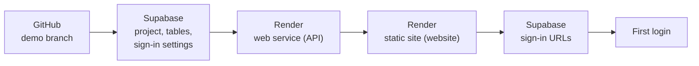

# Start hosting NirnAIn today: quick start

A short checklist for putting the demo online for free: the website and the API on **Render**, and the database and
sign-in on a **new Supabase project**. Each step links to the matching section of the full guide,
[docs/DEPLOY_DEMO.md](../DEPLOY_DEMO.md), which has the exact field values, the "check it worked" tests and the
troubleshooting table. This page doesn't repeat them. Keep the full guide open next to it.

**Total time:** about an hour (the guide's estimate). The step times below are approximate; most of the waiting is
Render's first build. No code changes are needed.

## Have these ready

- [ ] **The demo branch on GitHub.** Render builds from GitHub, so push `demo/mockup` first
      ([GITHUB_UPLOAD_STEPS.md](GITHUB_UPLOAD_STEPS.md), option A). Note which repository and branch you'll deploy,
      for example your fork `Dogiparthi-Sharada/AI-Assisted-Project-Planning-Platform`, branch `demo/mockup`.
- [ ] **Free accounts:** Supabase and Render. Sign up to Render with GitHub; it makes connecting the repository easier.
- [ ] **On your computer:** Git and Node.js 22 LTS (for one command that creates the database tables).
- [ ] **A private place for your values** (a password manager or a private note): the
      [values worksheet](../DEPLOY_DEMO.md#your-values-worksheet). Never paste these values into GitHub, an issue or a chat.
- [ ] **Two names** for your Render services, lowercase with `-`, for example `nirnain-api` and `nirnain-web`.
      They become `https://<name>.onrender.com`.
- [ ] Optional: an Anthropic API key for the AI features. Everything works without it.

## The checklist

| # | Step | Time | Full guide |
|---|---|---|---|
| 1 | Clone the repository (or use your local copy) and switch to the demo branch | 5 min | [Get the code](../DEPLOY_DEMO.md#get-the-code) |
| 2 | Create the Supabase project (name `nirnain-demo`, a letters-and-digits password, a region Render also has) | 5 min | [1.1](../DEPLOY_DEMO.md#11-create-the-project) |
| 3 | Copy the project URL and the **publishable** key (never the secret key) | 2 min | [1.2](../DEPLOY_DEMO.md#12-copy-the-project-url-and-the-publishable-key) |
| 4 | Check that sign-in tokens use the new signing keys (ECC or RSA) | 3 min | [1.3](../DEPLOY_DEMO.md#13-check-how-sign-in-tokens-are-signed) |
| 5 | Copy the **Session pooler** connection string and put your password in it | 3 min | [1.4](../DEPLOY_DEMO.md#14-copy-the-database-connection-string-session-pooler) |
| 6 | Create the tables: `npx supabase@latest login`, `link`, then `db push --remote` (17 migrations) | 10 min | [1.5](../DEPLOY_DEMO.md#15-create-the-database-tables-17-migrations) |
| 7 | Sign-in settings: Email on, **Confirm email off**, other providers off | 2 min | [1.6](../DEPLOY_DEMO.md#16-sign-in-settings-for-the-demo) |
| 8 | Connect Render to GitHub and create the **API web service** (Docker, root `backend`, 8 environment variables, health check `/health`) | 15 min (first build 5–10 min) | [2.1](../DEPLOY_DEMO.md#21-connect-render-to-github), [2.2](../DEPLOY_DEMO.md#22-create-the-web-service) |
| 9 | Create the **static site** (build command, publish `dist`, 5 environment variables) | 7 min (build about 2 min) | [3.1](../DEPLOY_DEMO.md#31-create-the-static-site) |
| 10 | Add the rewrite rule `/*` → `/index.html` (Rewrite), so deep links and reloads work | 2 min | [3.2](../DEPLOY_DEMO.md#32-add-the-rewrite-rule-deep-links-and-reloads) |
| 11 | Check that the API's `CORS_ORIGINS` is exactly the website's address | 2 min | [3.3](../DEPLOY_DEMO.md#33-make-sure-the-api-accepts-the-website) |
| 12 | Back in Supabase: Site URL and Redirect URLs = your website | 3 min | [Part 4](../DEPLOY_DEMO.md#part-4-sign-in-urls-back-in-supabase) |
| 13 | First login: wake the API (`/health`), sign up, land on the dashboard | 5 min | [Part 5](../DEPLOY_DEMO.md#part-5-first-login-end-to-end-check) |
| 14 | Optional: load the demo data (Jane Doe's five projects) with the seed script. Do it **before** step 15 for the full look | 5 min | [Part 6](../DEPLOY_DEMO.md#part-6-optional-load-demo-data) |
| 15 | Optional: add `ANTHROPIC_API_KEY` to the **API service only** | 3 min + redeploy | [2.4](../DEPLOY_DEMO.md#24-optional-switch-on-the-ai-features-anthropic_api_key) |

**Done when:** you can open `https://<web-name>.onrender.com/dashboard` in a new tab, reload it, and still see your
dashboard, signed in.

## Good to know

- **Before every demo, wake the API.** The free Render API sleeps after 15 minutes without requests and takes about
  a minute to wake. Open `https://<api-name>.onrender.com/health` and wait for `{"status":"ok",…}`
  ([2.3](../DEPLOY_DEMO.md#23-know-the-free-tier-sleep-cold-starts)). The website itself never sleeps.
- **A week without visitors** pauses the free Supabase project. Restore it from the Supabase dashboard; the data is
  kept ([Updating the demo later](../DEPLOY_DEMO.md#updating-the-demo-later)).
- **Code updates deploy themselves.** Every push to the branch you chose redeploys on Render. A new migration needs
  `npx supabase@latest db push --remote` again.
- **Don't run `supabase config push`** against the hosted project. The guide explains why (step 1.5).
- **The seed script isn't in the repository.** It is in the lead's session folder (`demo-seed/`, see the
  [final report's appendix](FINAL_PROJECT_REPORT.md#appendix-where-everything-is)). Its README has the exact command.
  Use `--ai-calls rules` only while the API has no `ANTHROPIC_API_KEY`, otherwise `--ai-calls skip`.
- **Something wrong?** The guide's [troubleshooting table](../DEPLOY_DEMO.md#troubleshooting) covers CORS errors, 401s,
  "Not Found" on reload, missing `VITE_…` values, migration errors and email limits.
- **Secrets stay out of the website.** Only the three `VITE_…` values go on the static site, and they are public by
  design. The database password and the Claude key go only on the API service.
